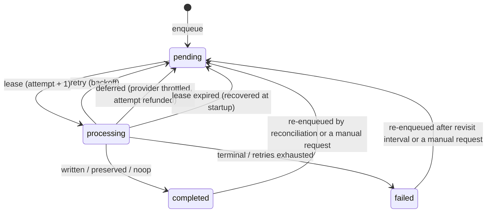

# Architecture

Versarr is a single-process, sidecar-first lyrics enrichment daemon.

- operational model: long-running daemon with watcher plus reconciliation
- persistence: same-directory `.lrc` sidecars are authoritative
- state: SQLite stores jobs, provenance, cooldowns, and scan checkpoints only
- provider: LRCLIB only in MVP
- interfaces: CLI plus `/health`, `/ready`, and `/metrics`

Terms are defined in [GLOSSARY.md](../GLOSSARY.md); decisions are recorded in [docs/adr](adr/README.md).

## Layers

```
interfaces (CLI, HTTP)  ->  bootstrap (VersarrRuntime)
application (services, job_policy, supervision, resilient_provider)
domain (entities, enums, normalization, hashing)
infrastructure (filesystem, persistence, provider)   implements application contracts (ports)
```

## Discovery

Jobs are created by three sources:

1. the **watcher** reports events, the stability detector waits for the file to settle, then a `watcher` job is queued
2. **reconciliation** at startup and every `reconciliation_interval_seconds` queues new, changed or stale tracks (incremental) and tombstones snapshots of deleted files
3. **control requests** written by `request-rescan` / `request-full-scan` are drained by the daemon

## Job lifecycle



Each attempt reads a snapshot, then the pure policy in `application/job_policy.py` decides to **preserve** (existing sidecar, manual edit, deleted sidecar, embedded lyrics), **skip** (cooldown active) or **fetch**. A fetch goes through the circuit breaker and pacer to LRCLIB (`/api/get`, then `/api/search` on a miss). Matches are written atomically with provenance.

## Failure handling

| Situation | Result |
| --- | --- |
| LRCLIB 429 / 5xx / network error / malformed body | transient: backoff and retry, up to `max_attempts` |
| repeated transient failures | circuit opens; jobs deferred without using attempts |
| LRCLIB 404 | `not_found` cooldown (7 days) |
| LRCLIB other 4xx | attempt fails, no cooldown |
| unexpected or filesystem error | backoff and retry, then `*_retry_exhausted` |
| background loop raises | logged, retried with backoff; `/health` reports `degraded` after repeated failures |
